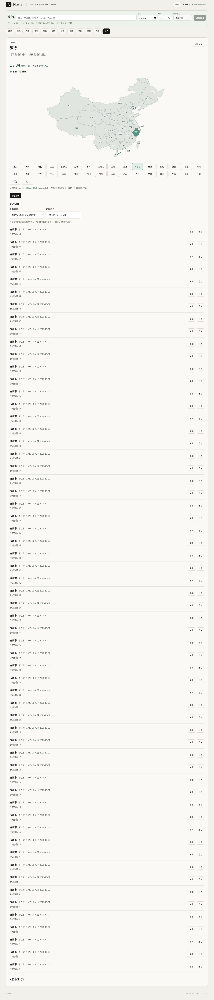
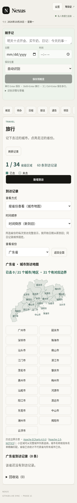
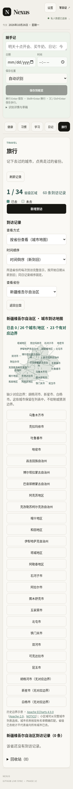

# 旅行 tab 读取性能（草稿）

2026-10-25，基于最新 main `decc49f78b81e8518a583bff05011f41196ebb29`。
只修改旅行读取及其取消处理，不改页面、地图、标签算法、写入或认证。
共享适配器增加可选的集合 REST reader；只有旅行传入，其他模块默认行为不变。
全部记录、令牌、认证响应和 GitHub API 都来自合成内存仓库，没有读写真实私人记录。

## 已确认的瓶颈与处理

1. **首次记录读取**：原实现先读取目录，再按 6 条一组逐文件请求；60 条需要
   61 次 API 请求、10 轮正文请求。接入现有 `readBlobTexts` 后，按已认证目录的
   SHA 读取不可变正文，默认每批 25 条、GraphQL 共享并发上限 4；60 条是
   1 次目录、3 次 GraphQL 请求。复用现有能力探测和错误处理，不要求新权限。
   旅行 REST 降级保留原有最多 6 个请求的上限，以工作池替代整批等待；同次加载的
   GraphQL 全部结束后才调用一次 REST reader，避免并发批次各自扩出 6 个请求。
   其他模块默认 REST 仍共享 4 个请求；本次没有提高通用额度。
2. **刷新重复下载**：原实现每次刷新下载全部正文。现在每次刷新仍请求远端目录，
   仅缺少或 SHA 改变的正文需要读取。删除的文件不从缓存补回；正文只保留在
   当前已认证适配器内存，不增加 localStorage、IndexedDB、离线读取或分析追踪。
   换适配器/重新登录仍需重读。完整 owner、路径、SHA、schema 校验通过才发布快照。
3. **同会话重复进入**：原有 `WorkspaceModuleLoader` 已合并成功及未完成读取，
   tab 已保留挂载。测量中重复切换没有旅行 API 请求，不应再增加一层过期缓存。
   每次点旅行回全国的呈现逻辑、未保存表单均保留。
4. **其他模块阻塞**：旅行依赖集合仅为旅行；故意将通告读取延迟 1.6 秒，
   旅行目录请求仍在通告完成前发起。隔离旅行打开时没有日记/健康请求。
5. **资源与渲染**：冷页面仍加载约 1.50 MB 未压缩静态资源，4 倍 CPU 降速下
   初始化有约 1.1 秒长任务；浏览器缓存命中后资源重传显著减少，但重新登录仍读记录。
   旅行首屏是全国地图，不加载省级城市 JSON，也不运行城市标签避让。
   正文完成到稳定画面约 0.1–0.25 秒。省级图的密集标签计算是另一条路径，
   广东桌面选择含资源和绘制约 1 秒；本次保留完整标签、引导线、小字号和无白色描边。

取消/退出登录会中止进行中的正文请求并停止排队工作；已发出的目录读取即使完成，
也必须通过当前会话校验才继续。重复点 tab 不取消有效的同会话读取，不发第二份快照。

优先级：减少首次记录请求和刷新重复正文、保持旅行 REST 首次读取水平（已实现）；
全工作台 bundle/初始化拆分需要另立范围，不能用该测量直接决定大改。
省级标签计算可单独做结果等价的测量优化，不应牺牲标签完整性。

## 同条件结果

以 [最终逐轮测量数据](travel-performance/measurement-final.json) 为准；GraphQL/REST
前后均各 5 轮；优化前使用 main 基线构建，优化后使用同一份最终应用构建。
文件同时记录应用源码 SHA-256 和
两种路径的浏览器回归。下表为中位数；[初轮数据](travel-performance/measurement-summary.json)
仅保留作为排查历史，不用于评估最终降级器。

| 60 条记录，GraphQL 可用，5 轮 | 优化前 | 优化后 | 旅行请求数 前 → 后 |
| --- | ---: | ---: | ---: |
| 新浏览器上下文，直接冷打开旅行 | 3,704 ms | 2,780 ms | 61 → 4 |
| 同上下文页面重载，静态资源暖缓存/新适配器 | 2,562 ms | 1,653 ms | 61 → 4 |
| 已连接通告页面，首次点击旅行 | 2,176 ms | 822 ms | 61 → 4 |
| 同会话切出再返回 | 272 ms | 267 ms | 0 → 0 |
| 手动刷新，远端未变化 | 1,674 ms | 304 ms | 61 → 1 |
| 冷打开中，目录完成至正文请求完成 | 1,358 ms | 252 ms | — |

运行环境：云端 Linux、系统 Chromium 151.0.7922.173、1440×1000、CPU 降速 4 倍；
真实生产静态构建，每次 API 响应额外固定延迟 100 ms；静态资源来自 loopback HTTP，
未压缩、不施加带宽限制；没有运行生产认证或真实 GitHub 数据读取。
“完整”定义为全部合成记录行出现、写入按钮可用后再经过两次 animation frame。
首次点击和切回计时含 Playwright 点击等待及绘制，不能当作纯 React 执行时间。
浏览器资源缓存实际启用，service worker 关闭；冷上下文与同上下文重载分开统计。
这些数字反映请求结构和本测试机差异，不能等同手机、用户网络或生产压缩后的速度。

### REST 降级复测与边界

当现有 token 不能用 GraphQL 时，适配器会探测一次后使用 SHA-pinned REST blob
读取。初轮直接沿用通用 4 并发使首次点击从 2,407 → 2,875 ms，故未作为最终方案；
最终旅行专用工作池恢复到原有 6 并发上限，先收束 GraphQL，再启动 REST。

| 60 条，GraphQL 403，5 轮 | 优化前 | 最终实现 | 旅行请求数 前 → 后 |
| --- | ---: | ---: | ---: |
| 新上下文冷打开 | 3,913 ms | 3,863 ms | 61 → 62 |
| 暖资源页面重载，新适配器 | 2,640 ms | 2,591 ms | 61 → 62 |
| 首次点击旅行 | 1,889 ms | 1,893 ms | 61 → 62 |
| 同会话切回 | 274 ms | 275 ms | 0 → 0 |
| 未变更刷新 | 1,690 ms | 278 ms | 61 → 1 |
| 首次点击中，目录完成至正文完成 | 1,392 ms | 1,366 ms | — |

首次点击约 4ms（0.2%）差异相对逐轮波动可视为基本持平，不宣称 REST 首次提速。
前后所有测量的旅行正文请求峰值均为 6；GraphQL 路径本数据集的最终峰值为 2。
尚未探测的适配器仍多 1 次 GraphQL 能力探测；已确认不支持后不重复探测。
没有增加权限、并行双通道、提前读取其他业务记录或持久保存能力结果。
5 轮合成结果不能证明所有设备和网络下严格零差异，尤其探测接口异常缓慢时；
本次消除的是原 4 并发引入的明显退步，并保留现有错误/限流不扩散规则。

## 验证状态

- 相关适配器/旅行/导航初步测试：5 个文件、119 项通过。
- 生产 PWA 构建通过；全仓 `pnpm lint`、`pnpm typecheck` 通过，
  全量 Vitest 172 个文件、1,752 项全部通过。lint 仅有已有的根目录 pages 提示。
- 合成 Chromium：冷/暖打开、同会话重复切换、每次点 tab 返回全国、表单保留、
  编辑保存、SHA 冲突保留输入/刷新重选、软删除恢复、远端修改/移除、新适配器读取、
  401 后缓存不能绕过核对、限流/不完整批次阻止部分展示和写入、显式重试恢复均通过。
- 1440/390/320px：34 个全国区域、广东/新疆/贵州/台湾省级切换；城市标签文字完整、
  标签框无相交、无裁切、无横向溢出、无白色描边；地图失败时完整城市列表保留，
  返回后重选可恢复；快速切省最终显示目标省份。浏览器无未捕获异常。
- 最终 GraphQL 与 REST 各完整运行一次上述回归；另增加读取中切 tab 的单次请求、
  退出登录取消、清空后无排队读取或旧记录复现、恢复会话重新读正文。
  单元测试覆盖取消/重试、旧目录结果丢弃、REST 峰值 6、默认其他集合峰值 4、
  GraphQL 与专用 REST 不重叠、失败输出不入缓存；变更/删除刷新及适配器隔离均通过。
  新增取消检查首轮暴露合成服务器未捕获请求流 `ECONNRESET`，修复测试工具后两套重跑通过。
- 未执行已知不适用的根目录 `pnpm build`；正式静态 PWA 使用 `build:github-pwa`。
- 未合并、未推送 main、未触发生产部署；没有新持久权限或真实用户数据读写。
- 同一云端合成预览的独立浏览器冒烟通过：60 条完整记录可见，无页面未捕获异常。
- GitHub 部署列表只读查询返回 `Forbidden`，未重试；通过 PR 官方 Cloudflare 机器人评论
  确认已有分支预览。没有额外部署或开放端口；最终 head 对应状态见 PR 机器人记录。

## 可复现测量与合成预览

测试工具不进入应用 bundle，也不增加仓库依赖；需要 Node 24、Chromium 和 Playwright。
在独立目录准备上述 main 的静态构建后，对前后构建使用同一份当前测试脚本：

```sh
npm install --prefix /tmp/travel-perf --cache /tmp/travel-npm-cache playwright@1.64.1
export PLAYWRIGHT_MODULE=/tmp/travel-perf/node_modules/playwright/index.mjs
pnpm build:github-pwa
node scripts/benchmark-travel.mjs --out /tmp/travel-baseline-out --result /tmp/travel-before.json
node scripts/benchmark-travel.mjs --result /tmp/travel-after.json
node scripts/benchmark-travel.mjs --out /tmp/travel-baseline-out --runs 5 --rest-only --result /tmp/travel-before-rest.json
node scripts/benchmark-travel.mjs --runs 5 --rest-only --result /tmp/travel-after-rest.json
node scripts/benchmark-travel.mjs --runs 0 --verify --result /tmp/travel-verification.json
node scripts/benchmark-travel.mjs --runs 0 --verify --rest-only --result /tmp/travel-verification-rest.json
node scripts/benchmark-travel.mjs --preview --port 4173
```

最后一条启动独立的合成数据预览（`http://127.0.0.1:4173/#workspace-panel-travel`），
只在测试服务器提供 HTML 时注入合成传输，不修改 `out/` 或生产代码。预览中的
新增/编辑只写当前进程的合成内存；外部 fetch 被阻止，真实登录不可用。
已有 [Cloudflare 分支预览](https://perf-travel-first-open.personal-workspace-app.pages.dev)，
不要求另开端口或部署。它是独立预览域名；合成编辑验证使用上述隔离工具。
下方截图也可直接审阅，均为最终构建的合成数据。




